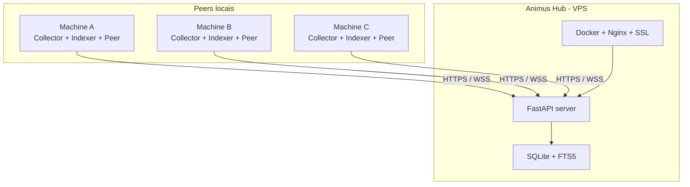

# ⟁ Animus

> Rede peer-to-peer de sincronização de memórias dos seus assistentes de IA.

> **Animus** é uma rede de sincronização de memórias do GitHub Copilot, Claude Code e Google Antigravity / Antigravity IDE. Coleta, indexa e sincroniza o contexto das suas interações com IA entre todas as suas máquinas. O nome e parte da estética são uma referência cultural à franquia *Assassin's Creed*, mas este projeto não é afiliado, endossado ou patrocinado pela Ubisoft — ver [Aviso](#-aviso-marcas-e-afiliação).

## Conceito

| AC Lore | Animus System |
|---------|---------------|
| Animus | O sistema completo |
| Memórias Genéticas | Interações do Copilot, chat logs, contextos |
| Subject (Desmond) | Sua máquina — um nó peer |
| Hub central | Servidor agregador na VPS |
| Bleeding Effect | Cross-context: memórias de outros nós disponíveis localmente |
| Eagle Vision | Busca full-text + semântica em todas as memórias |
| Brotherhood | Rede peer-to-peer de sincronização |
| Synchronization | Processo de sync com o hub |
| Leap of Faith | CLI para entrar no Animus |

## Integracao experimental com Obsidian

O Obsidian pode ser usado como camada humana de conhecimento curado, mantendo a memoria automatica, a sincronizacao e o acesso por MCP no Animus. A integracao e opt-in, suporta varios vaults, coleta incremental, frontmatter YAML, tags e links, e exporta somente para a area gerenciada `.animus/exported/`.

```bash
animus obsidian vault-add pessoal C:\Notas\Pessoal --enable-collection --allow-export
animus obsidian status
animus obsidian collect
animus obsidian export --vault pessoal --id <memory-id> --dry-run
animus obsidian export --vault pessoal --id <memory-id>
animus obsidian catalog --vault pessoal --install-style
animus obsidian search "termo" --vault pessoal
animus obsidian dataset --vault pessoal --kind rag
animus obsidian dataset --vault pessoal --kind sft
animus obsidian organize --vault pessoal --id <memory-id>
animus obsidian organize --vault pessoal --id <memory-id> --apply --approve
animus obsidian rollback --vault pessoal
```

Notas exportadas começam como candidatas: somente conhecimento verificado entra no corpus RAG, e fine-tuning exige ainda um par instrução/resposta aprovado explicitamente. Notas humanas nunca são sobrescritas. Edicoes divergentes em notas gerenciadas geram uma copia em `.animus/quarantine/`; atualizacoes geram backup e registro em `.animus/audit.jsonl`. Consulte o [guia da camada de conhecimento](docs/CAMADA-CONHECIMENTO-OBSIDIAN.md) e o [plano de integração](docs/PLANO-INTEGRACAO-OBSIDIAN.md).

Conteúdo Markdown curado deve entrar por arquivo ou `stdin`, com quebras de
linha reais. Na exportação, o Animus corrige documentos inteiros que tenham
sido serializados por engano com `\\n` literais, sem alterar JSON bruto nem
exemplos de código que apenas mencionem `\\n`.

## Arquitetura



## O que coleta

| Fonte | Tipo | Descrição |
|-------|------|-----------|
| Copilot Chat | `copilot_chat` | Conversas de chat do Copilot |
| Debug Logs | `copilot_debug` | Logs de sessão/debug |
| `copilot-instructions.md` | `workspace_memory` | Instruções de workspace |
| `.instructions.md` | `workspace_memory` | Instruções do projeto |
| `.prompt.md` files | `prompt_file` | Prompt files customizados |
| `.agent.md` files | `agent_file` | Agentes customizados |
| `/memories/` | `user_note` | Notas persistentes do usuário |
| `/memories/session/` | `session_note` | Notas de sessão |
| `/memories/repo/` | `repo_note` | Memórias do repositório |
| MCP Memory | `mcp_knowledge` | Knowledge graph do MCP server |
| Claude Code transcripts (`~/.claude/projects/*/<sid>.jsonl`) | `claude_chat` | Turnos de sessão do Claude Code (com `session_title` derivado do primeiro prompt) |
| Claude Code auto-memory (`~/.claude/projects/*/memory/*.md`) | `claude_memory` | Memórias persistentes do Claude Code com frontmatter `name`/`description`/`metadata.type` (user/feedback/project/reference) |
| Antigravity CLI (`~/.gemini/antigravity/conversations/*.db`) | `antigravity_chat` | Turnos de chat do `agy` (extração de texto a partir dos blobs protobuf do SQLite) |
| Antigravity IDE (`~/.gemini/antigravity-ide/conversations/*.db`) | `antigravity_chat` | Turnos de chat do Antigravity IDE |
| Antigravity brain (`~/.gemini/antigravity/brain/<conv>/*`) | `antigravity_memory` | Memory files persistentes do agente (scratch, system_generated, user_uploaded) |
| Antigravity global `GEMINI.md` (`~/.gemini/GEMINI.md`) | `antigravity_memory` | Identidade/regras globais carregadas em toda conversa |
| Antigravity projects (`~/.gemini/config/projects/*.json`) | `antigravity_knowledge` | Metadados de projeto do Antigravity |
| `.antigravity/mcp.json` | `antigravity_knowledge` | Registro de MCP servers por workspace |
| Vaults Obsidian configurados (opt-in) | `obsidian_note` | Notas Markdown curadas, com YAML, tags e links |

## Instalação

### Peer (cada máquina)

#### Opção A — Self-install ZIP (recomendada)

No hub, abra **`/admin/peers`** → aba **📦 Self-install ZIP** → clique em
**Generate Installer ZIP**. O ZIP gerado (~8 KB) já vem com o `hub_url`,
`server_secret` e um `node_id` novo embutidos em `peer.env`.

Na máquina alvo:

```bash
# Linux / macOS
unzip animus-peer-<id>.zip && cd animus-peer-<id>
./install.sh

# Windows
# extrair o ZIP, então duplo-clique em install.bat (sem UAC)
```

Sem prompts — o kit já sabe tudo e instala Python 3.13/Git no escopo do usuário
quando necessário. Inclui `COPILOT.md`: passo-a-passo para o
GitHub Copilot fazer a instalação manual em VS Code quando o shell estiver
restrito.

#### Opção B — One-liner (irm | iex / curl | bash)

Veja a aba **🐧 Linux/macOS** ou **🪟 Windows (PowerShell)** no `/admin/peers`.

#### Opção C — Editable / dev install

```bash
cd animus
pip install -e .

# Inicializar
animus init

# Coletar memórias locais
animus collect

# Buscar (Eagle Vision)
animus search "como configurar deploy docker"

# Ver estatísticas
animus stats
```

#### Após a instalação — comandos úteis

```bash
# Status do daemon
systemctl status animus-peer            # root install
systemctl --user status animus-peer     # user install
Get-ScheduledTask AnimusPeerDaemon      # Windows

# Ver / trocar a URL do hub (use sempre a URL pública HTTPS,
# nunca um IP interno do bridge Docker — ele muda a cada restart)
animus config-show
animus config-set hub_url https://animus.datano.com.br

# Sync manual
animus sync
animus stats
```

Cada sync anuncia versão do Animus, hostname e SO ao Hub. Em
`/admin/peers`, a identificação usa alias configurado, depois hostname e,
por último, `node_id`.

> ⚠️ **`hub_url` precisa ser alcançável de onde o peer roda.** Se o peer
> está no host (ou em outra máquina), aponte para a URL pública (HTTPS via
> Nginx). IPs `172.x` / `10.x` do bridge Docker só funcionam para peers
> que rodam **dentro** da mesma rede do compose — e mesmo assim, prefira
> o nome do serviço (`http://animus:8314`) em vez de IP fixo.

### Hub (VPS)

```bash
# Na VPS, dentro de /opt/vps-hub/
git clone <repo> animus
cd animus

# Copiar e editar env
cp .env.example .env
# Editar .env → definir ANIMUS_SERVER_SECRET

# Deploy
./vps-hub/deploy.sh

# Ou via docker compose direto
docker compose up -d
```

### Conectar Peer ao Hub

```bash
# No peer, configurar URL do hub
animus config set hub_url https://animus.datano.com.br

# Definir o mesmo secret do hub
animus config set server_secret <MESMO_SECRET_DO_HUB>

# Sync manual
animus sync

# Ou rodar como daemon (collect + sync contínuo)
animus daemon
```

## MCP — consumir as memórias no Copilot / Claude Code

Cada peer expõe um **servidor MCP** (`animus-mcp`) sobre stdio com 16
ferramentas (`animus_search`, `animus_recall`, `animus_session`,
`animus_session_list`, `animus_related`, `animus_neural_map`,
`animus_remember`, `animus_stats`, `animus_collect`, `animus_context`,
`animus_timeline`, `animus_obsidian_guide`, `animus_obsidian_search`, `animus_obsidian_export`,
`animus_obsidian_organize`, `animus_obsidian_dataset`). Qualquer host MCP-aware — Copilot Chat (VS Code),
Claude Code, ou outro — passa a ler/escrever na sua memória sincronizada.

### Claude Code

A partir de v0.5.0 o `install-peer.{sh,ps1}` detecta `~/.claude.json` e
registra o MCP automaticamente. Resultado: ao reiniciar o Claude Code, as
16 ferramentas aparecem.

Override via env:

```bash
ANIMUS_INSTALL_CLAUDE_MCP=yes  bash install-peer.sh   # força (default quando ~/.claude.json existe)
ANIMUS_INSTALL_CLAUDE_MCP=no   bash install-peer.sh   # desativa
```

Em peers antigos (pré-v0.5.0) ou para registrar manualmente, ver
[CLAUDE.md](./CLAUDE.md) — script Python idempotente que edita
`~/.claude.json` sem quebrar o resto da config.

### REST API alternativa

Quando não dá pra rodar um peer local (sandbox, CI, agent remoto), bata
direto na API HTTP do hub:

```bash
# Auth: HMAC-SHA256 (ver animus/network/crypto.py) — ou rode em dev sem secret
curl -s https://animus.datano.com.br/health
curl -s https://animus.datano.com.br/api/version
curl -s -X POST -H 'X-Animus-Node: <node_id>' -H 'X-Animus-Timestamp: <ts>' \
        -H 'X-Animus-Signature: <hmac>' -H 'Content-Type: application/json' \
        -d '{"query":"docker deploy","limit":5}' \
        https://animus.datano.com.br/api/search
```

Endpoints públicos (sem secret): `/`, `/health`, `/api/version`. Os demais
exigem assinatura HMAC do body — ver
[`animus/network/crypto.py`](animus/network/crypto.py).

## Auto-update (peers se atualizam sozinhos)

A partir de v0.5.0 o daemon peer **checa o hub** periodicamente e instala a
versão nova sem intervenção — tanto Linux/macOS (systemd / launchd) quanto
Windows (Scheduled Task).

### Fluxo

1. Hub expõe `GET /api/version` (sem auth) com:
   ```json
   {
     "latest": "0.5.0",
     "min_compat": "",
     "channel": "stable",
     "package_url": "/api/peers/package.whl",
     "install_url": "git+https://github.com/GuilhermeP96/animus.git",
     "git_ref": "main",
     "notes": ""
   }
   ```
2. Peer compara `latest` com `animus.__version__`. Se for mais nova, autentica
   com o HMAC já configurado e baixa `/api/peers/package.whl` da própria VPS.
   Versão, origem e SHA-256 são validados antes do `pip install`. Hubs antigos
   continuam usando `install_url`/`git_ref` como fallback.
3. Em Linux/macOS o upgrade roda diretamente e o peer faz `os.execv`. No
   Windows, um helper desacoplado espera o daemon sair, libera launchers
   legados/MCP que estejam bloqueando o venv, executa o `pip` e registra o
   resultado em `%TEMP%\animus-self-update.log`.
4. O peer sai com código `75` (EX_TEMPFAIL) quando precisa do supervisor;
   systemd ou a Scheduled Task inicia a versão nova.
5. O check roda no startup e em até 15 minutos. Valores antigos de 6 horas
   são limitados em runtime para que peers existentes também convirjam.

O ZIP em `/admin/peers` é idempotente: usando o ID de um peer existente ele
reaproveita sua identidade registrada e serve como pacote de update/reparo.
O próprio peer também pode obter seu ZIP em `/api/peers/update-kit.zip` usando
a autenticação HMAC já configurada. A imagem Docker do Hub mantém em
`/opt/animus-packages` o wheel da versão que está executando, portanto o pacote
servido e o `latest` permanecem alinhados a cada deploy.

### Comandos

```bash
# Ver versão local + remota
animus self-update --check

# Forçar reinstalação (mesmo já estando na versão atual — útil pós-corrupção)
animus self-update --force

# Atualizar sem reiniciar (scripts; no Windows a saída breve é obrigatória)
animus self-update --no-restart

# Desligar o auto-update no daemon
animus config-set auto_update_enabled false
animus config-set update_check_interval_seconds 900     # 15 min (default/max)
animus config-set update_allow_pre false                # opt-in a --pre
```

### Operacional no hub

Permite parar uma rollout / pinning sem rebuild da imagem — env vars no
container do hub (`docker compose exec` ou no `.env` do compose):

| Variável                | Efeito |
|-------------------------|--------|
| `ANIMUS_PIN_VERSION`    | Sobrescreve `latest` (ex.: `0.4.15` para travar peers) |
| `ANIMUS_GIT_REF`        | Aponta para uma tag/branch específica (`v0.5.0-rc.1`) |
| `ANIMUS_CHANNEL`        | `stable`/`beta` — informativo (clientes não bloqueiam) |
| `ANIMUS_INSTALL_URL`    | Repo alternativo (mirror, fork) |
| `ANIMUS_MIN_COMPAT`     | Versão mínima esperada (informativo) |
| `ANIMUS_RELEASE_NOTES`  | Mensagem opcional surfacede no CLI |

### Quando o peer recusa auto-update

* Install em diretório read-only / pacote do SO / `pipx` — refuses, loga e
  continua na versão atual.
* `pip` não encontrado ao lado de `sys.executable` (instalação manual fora
  de venv) — mesma resposta.
* `hub_url` vazio — pulado.

Nesses casos o operador deve reinstalar manualmente (`pip install --upgrade
git+https://github.com/GuilhermeP96/animus.git@main`) ou rodar o script
`install-peer.sh` de novo, que recria o venv writable.

## Conectividade

O Animus usa um modelo **hub-and-spoke**: peers sempre conectam **outbound** ao hub. Isso significa que **não precisa de admin, firewall rules, ou instalações complexas** nos devices.

### Opção 1: Direto (recomendado)
Se a VPS tem IP público e porta 8314 aberta:
```bash
animus config set hub_url https://animus.datano.com.br
```

### Opção 2: SSH Tunnel
Se quer rodar tudo isolado:
```bash
animus config set tunnel_mode ssh
animus config set tunnel_ssh_host SEU_VPS_IP
animus config set tunnel_ssh_user SEU_USUARIO
animus config set tunnel_ssh_key ~/.ssh/id_ed25519
animus tunnel ssh
```

### Opção 3: Chisel (single binary, sem SSH)
```bash
# No hub (VPS), ativar chisel:
docker compose --profile tunnel up -d

# No peer:
animus config set tunnel_mode chisel
animus tunnel chisel
```

### Opção 4: Cloudflare Tunnel (HTTPS grátis)
```bash
animus tunnel cloudflared
```

## Compatibilidade VPS Hub

O Animus é 100% compatível com o VPS Hub (`/opt/vps-hub/`):

```bash
# Deploy via VPS Hub
cd /opt/vps-hub
./scripts/deploy.sh animus

# Ou standalone
cd /opt/vps-hub/animus
./vps-hub/deploy.sh
```

Arquivos de integração:
- `vps-hub/deploy.sh` — Script de deploy compatível
- `vps-hub/animus.service` — Systemd service
- `vps-hub/nginx.conf` — Nginx reverse proxy (SSL/WebSocket)

## API

O hub expõe uma API REST + WebSocket:

| Endpoint | Método | Descrição |
|----------|--------|-----------|
| `/` | GET | Status do hub |
| `/health` | GET | Health check |
| `/api/stats` | GET | Estatísticas |
| `/api/sync/push` | POST | Enviar memórias |
| `/api/sync/pull` | POST | Receber memórias |
| `/api/search` | POST | Buscar (Eagle Vision) |
| `/api/memories/recent` | GET | Memórias recentes |
| `/api/peers` | GET | Peers conectados |
| `/ws/sync` | WS | Sync em tempo real |
| `/docs` | GET | Swagger UI |

## CLI Commands

```
animus init          # Inicializar no device
animus collect       # Coletar memórias
animus search QUERY  # Buscar (Eagle Vision)
animus stats         # Estatísticas
animus sync          # Sync com hub
animus daemon        # Daemon (collect + sync loop)
animus serve         # Rodar como hub
animus tunnel MODE   # Iniciar tunnel (ssh|chisel|cloudflared)
animus config-show   # Ver configuração
animus config-set K V # Alterar configuração
animus obsidian status # Estado dos vaults e da coleta
animus obsidian collect # Coletar somente notas do Obsidian
animus obsidian export  # Exportar memorias para a area gerenciada
animus obsidian catalog # Gerar a entrada única, mapas e Canvas
animus obsidian search  # Consultar a camada verificada (Gold)
animus obsidian dataset # Validar/gerar corpus RAG ou fine-tuning
animus obsidian organize # Propor/aplicar organizacao auditada
animus obsidian rollback # Restaurar a ultima alteracao com backup
```

## Segurança

- HMAC-SHA256 para autenticação peer-to-peer
- Timestamp validation (replay protection, 5min window)
- Shared secret derivation per-node
- HTTPS/WSS em produção (via nginx + certbot)
- Sem dados sensíveis no conteúdo (tokens, passwords são filtrados)
- Outbound-only connections (sem necessidade de abrir portas no peer)
- Licença por `node_id` aplicada pelo Hub através do plano de controle Datano;
  suspensão e revogação são efetivas em HTTP e WebSocket após o cache curto.

### Plano de controle de licenças

Em produção, o Hub recebe `ANIMUS_LICENSE_API_URL` e
`ANIMUS_LICENSE_API_SECRET`. O segredo é exclusivo da comunicação interna
entre containers e nunca é enviado aos peers. O primeiro contato de um peer
HMAC autenticado pode provisionar uma licença `community`; depois disso o
status, plano, grupo e vigência são administrados no dashboard da Datano.

`ANIMUS_LICENSE_CACHE_SECONDS` controla o cache de decisão (60 segundos por
padrão) e `ANIMUS_LICENSE_OFFLINE_GRACE_SECONDS` limita por quanto tempo uma
concessão previamente validada sobrevive a uma indisponibilidade transitória
do plano de controle (24 horas por padrão).

## Stack

- **Python 3.10+**
- **FastAPI** + **Uvicorn** — HTTP/WebSocket server
- **SQLite FTS5** — Full-text search engine
- **httpx** — Async HTTP client
- **websockets** — WebSocket client
- **watchdog** — File system monitoring
- **Typer** + **Rich** — CLI
- **Docker** — Hub deployment
- **Chisel** (opcional) — TCP tunnel

## License

MIT

## 📝 Aviso (marcas e afiliação)

"Animus" e a estética visual do projeto (terminologia como *Eagle Vision*,
*Brotherhood*, *Leap of Faith* etc.) são uma homenagem cultural à série
*Assassin's Creed*, criada e publicada pela **Ubisoft Entertainment SA**.

Este projeto **não é afiliado, endossado, patrocinado ou aprovado** pela
Ubisoft. Todas as marcas e elementos de propriedade da Ubisoft pertencem a
seus respectivos titulares. O uso aqui é nominativo / referencial — para
descrever um conceito de "sincronização de memórias" inspirado na franquia
— em um software open-source sem fins lucrativos, sem reutilizar arte
oficial, áudio, código ou roteiro.

Se você é representante da Ubisoft e considera que algum elemento deveria
ser ajustado, abra uma issue ou contate o mantenedor antes de qualquer
ação formal: estamos abertos a remover/renomear o que for solicitado.
