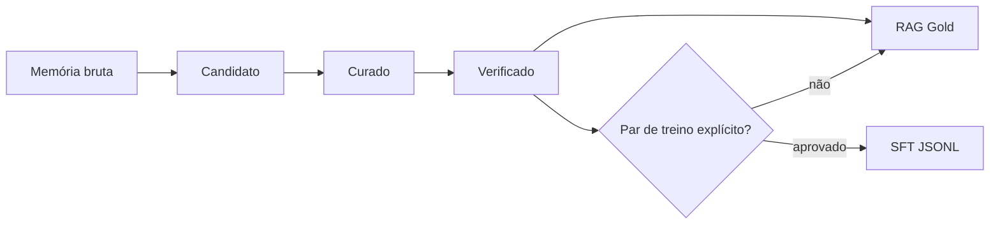

# Camada de conhecimento Obsidian

O Obsidian é o **Knowledge OS** do Animus: a superfície onde memórias recuperáveis
se tornam conhecimento governado. Ele não substitui o índice Animus e não deve ser
usado como um depósito de transcrições.

## Separação das camadas

| Camada | Conteúdo | Uso |
|---|---|---|
| Bronze — Animus | Conversas, logs e memórias automáticas | Busca ampla, evidência e auditoria |
| Silver — Obsidian candidato | Exportações classificadas automaticamente | Triagem, deduplicação e ligação |
| Gold — Obsidian verificado | Conhecimento conferido e vigente | RAG, contexto dos agentes e decisões |
| Training — JSONL aprovado | Pares explícitos de instrução e resposta | Fine-tuning supervisionado |

Fine-tuning não é um mecanismo de atualização factual. Fatos, arquitetura em mudança,
estado de projetos e procedimentos versionados devem permanecer no RAG. Fine-tuning é
adequado para comportamento repetível: tom, formato, critérios de decisão, sequência
de ferramentas e respostas exemplares.

## Ciclo obrigatório



- `candidato`: exportado e classificado automaticamente; ainda não confiável.
- `curado`: título, projeto, tipo, links e duplicidade revisados.
- `verificado`: conteúdo comparado com a fonte e sem contradição conhecida.
- `depreciado`: preservado para histórico, excluído dos datasets.

## Propriedades das notas

```yaml
projeto: Animus
projeto_manual: false         # true preserva a classificação humana
classificacao: automatica
tipo: decisao                 # fato | decisao | procedimento | arquitetura | preferencia | exemplo
status: verificado            # candidato | curado | verificado | depreciado
sensibilidade: interno        # publico | interno | restrito
fonte: user_note
mapa: "[[.animus/exported/Sistema/Projetos/Animus]]"
treino:
  aprovado: false
  sistema: ""                # opcional
  instrucao: ""              # obrigatório para SFT
  resposta: ""               # obrigatório para SFT
```

Exportação automática nunca define `verificado` ou `treino.aprovado: true`. Material
`restrito` é sempre rejeitado. Por padrão, datasets também rejeitam material `interno`;
incluí-lo exige `--include-internal` explícito. Uma varredura adicional bloqueia padrões
de tokens, senhas, chaves de API e chaves privadas, independentemente dos metadados.

## Funil de consulta do agente

1. Abrir a única entrada `00 - Início`.
2. Escolher o mapa do projeto.
3. Usar `animus_obsidian_search`, que retorna apenas `verificado` por padrão.
4. Incluir candidatos somente como pista explícita; depois usar `animus_search` para evidência bruta.
5. Comparar origem e data; registrar conflitos em vez de escolher silenciosamente.
6. Citar o título ou `memory_id` que sustentou a ação.

O mesmo contrato está disponível por `animus_obsidian_guide` e pelo recurso MCP
`animus://obsidian/guide`.

## Geração e validação

```bash
# Painel, mapas de projeto, Canvas, metadados e estilo opcional
animus obsidian catalog --vault Panthro --install-style

# Ver o que seria aceito no corpus RAG
animus obsidian dataset --vault Panthro --kind rag

# Gerar o corpus após revisar a contagem/rejeições
animus obsidian dataset --vault Panthro --kind rag --apply

# SFT: aceita somente notas verificadas com treino.aprovado e par completo
animus obsidian dataset --vault Panthro --kind sft
animus obsidian dataset --vault Panthro --kind sft --apply
```

Cada JSONL recebe um manifesto com contagens, motivos de rejeição e proveniência. Antes
de qualquer upload para um provedor de modelo, revise o manifesto, faça amostragem
manual, separe treino/validação/teste e execute avaliações de regressão.

## Regras de manutenção

- Uma nota deve responder a uma pergunta principal.
- Atualize a nota canônica em vez de criar uma duplicata temporal.
- Todo conhecimento pertence a um mapa de projeto; órfãos ficam em `Geral — revisar`.
- Nunca copie `.env`, tokens, credenciais ou segredos para o vault ou dataset.
- Nota humana explícita tem precedência sobre síntese automática.
- Mudanças geradas ficam em área gerenciada, com backup, auditoria e rollback.
- Recrie painel e datasets depois de uma rodada de curadoria.

## Métricas de saúde

- proporção `verificado / total` por projeto;
- candidatos sem revisão há mais de 30 dias;
- notas em `Geral — revisar`;
- duplicatas e links quebrados;
- exemplos SFT aprovados por tipo de tarefa;
- cobertura e taxa de acerto das avaliações antes/depois do ajuste.
