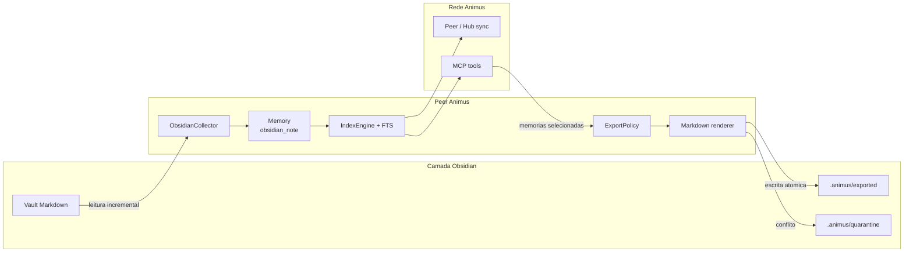
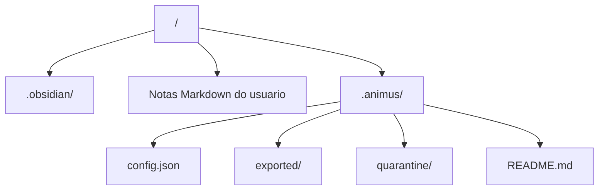
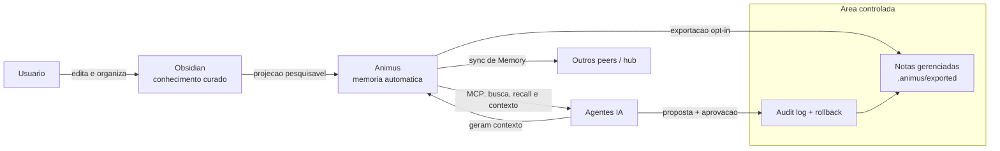
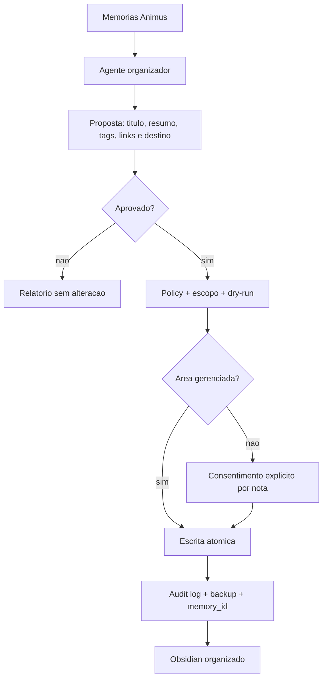
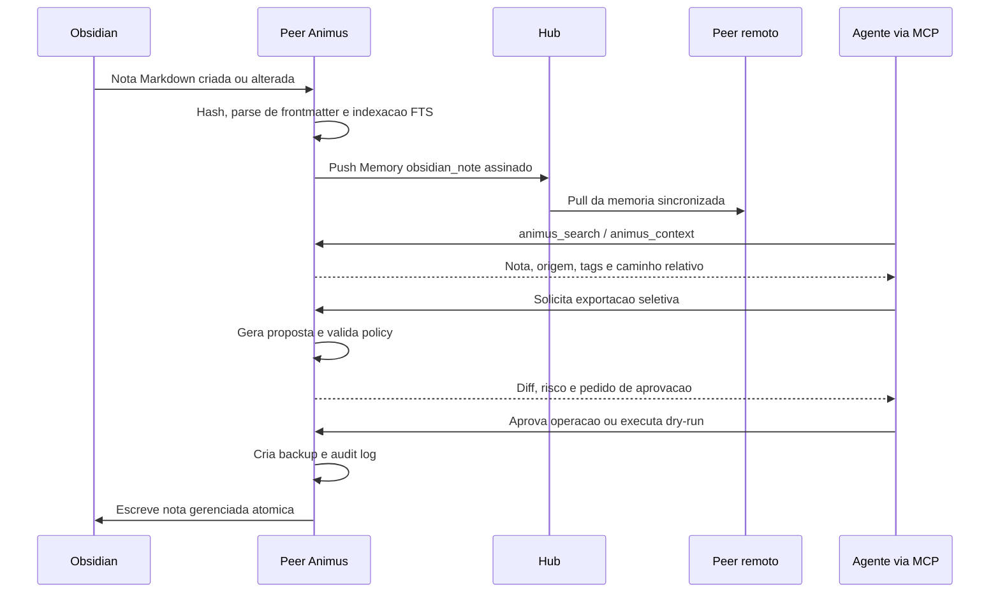

# Plano de integracao Obsidian + Animus

**Status:** MVP experimental implementado na v0.7.0
**Data:** 2026-09-05  
**Base:** Animus v0.7.0
**Objetivo:** combinar o Obsidian como camada humana e curada de conhecimento com o Animus como memoria automatica, pesquisavel e compartilhada entre agentes e maquinas.

## 1. Decisao de produto

O Obsidian e o lugar onde o conhecimento ganha forma: notas, decisoes, projetos, referencias e links mantidos pelo usuario.

O Animus e o sistema que captura contexto automaticamente: conversas, memorias de agentes, instrucoes, sessoes, MCP e fontes de varias maquinas.

A integracao nao deve transformar o vault em um deposito de logs. O principio central sera:

> O Animus coleta contexto bruto; o Obsidian guarda conhecimento curado; os links entre ambos preservam rastreabilidade.

### Resultado esperado

- Agentes conseguem consultar notas relevantes do Obsidian pelo MCP.
- O Animus consegue exportar memorias selecionadas para Markdown legivel.
- Notas exportadas mantem origem, id, timestamp e link para a memoria original.
- O usuario decide o que entra no vault e o que permanece apenas no indice do Animus.
- Agentes podem classificar, resumir, relacionar e organizar memorias no vault com politicas claras.
- A sincronizacao entre maquinas continua sendo responsabilidade do Animus, sem depender do Obsidian Sync.

## 2. Estado atual do Animus

A base v0.6.0 ja oferece:

- coletores de Copilot Chat, Copilot CLI, Claude Code e Antigravity;
- memorias persistidas com `id`, `type`, `source_path`, `workspace`, `timestamp`, `metadata`, `tags` e `sequence`;
- indice FTS e busca pelo MCP;
- ferramentas MCP para busca, recall, sessoes, contexto, memoria manual, coleta e timeline;
- sincronizacao peer/hub entre maquinas;
- servidor hub e painel administrativo.

A integracao com Obsidian deve reutilizar esse modelo, sem criar um segundo banco de dados de memorias.

## 3. Escopo do MVP

### Incluido

1. Configurar um ou mais vaults locais por peer.
2. Detectar notas Markdown do vault de forma incremental.
3. Indexar notas como um novo tipo de memoria, inicialmente `obsidian_note`.
4. Extrair frontmatter YAML, tags, links Wiki e links Markdown.
5. Buscar notas do Obsidian pelos recursos existentes do Animus.
6. Exportar memorias escolhidas para uma pasta controlada do vault.
7. Inserir frontmatter de rastreabilidade nas notas exportadas.
8. Impedir loops de importacao/exportacao por meio de IDs e marcadores de origem.
9. Oferecer comandos CLI para configurar, importar, exportar e mostrar o estado.
10. Cobrir o fluxo com testes unitarios e um teste de integracao em vault temporario.
11. Permitir organizacao assistida por agentes, com modo proposta, aprovacao e auditoria.

### Fora do MVP

- Editar arbitrariamente notas do usuario pelo hub.
- Sincronizar o vault inteiro pelo hub sem opt-in.
- Resolver conflitos complexos de edicao concorrente.
- Implementar um grafo visual proprio para substituir o Graph View do Obsidian.
- Depender de plugin obrigatorio do Obsidian.
- Copiar automaticamente todas as conversas brutas para o vault.
- Substituir o Obsidian Sync, Git ou qualquer ferramenta de backup do usuario.
- Permitir que agentes sobrescrevam notas humanas fora de areas gerenciadas.

## 4. Arquitetura proposta



### Fonte de verdade

- O conteudo de uma nota criada pelo usuario pertence ao Obsidian.
- A memoria indexada pelo Animus e uma projecao pesquisavel da nota.
- Uma nota exportada pelo Animus pertence ao Animus enquanto estiver na pasta gerenciada.
- O hub sincroniza memorias, nao arquivos arbitrarios do vault.

### Pasta recomendada no vault



A pasta `.animus/` deve ser ignorada pelo fluxo normal do usuario, mas continuar disponivel para auditoria e backup. A configuracao efetiva do peer permanece no diretorio de dados do Animus; o arquivo no vault serve apenas para metadados e estado local da integracao.

### Responsabilidade e fonte de verdade



O conteudo manual do vault tem autoridade no fluxo Obsidian -> Animus. Uma nota exportada so pode ser atualizada automaticamente quando possuir o mesmo `memory_id` e `managed: true`. Agentes podem organizar notas dentro de areas explicitamente gerenciadas, mas toda acao precisa ser rastreavel e reversivel.

### Organizacao assistida por agentes

O agente nao deve apenas consultar memorias: ele pode transforma-las em conhecimento navegavel no Obsidian. O comportamento padrao sera propor primeiro e executar depois da aprovacao, com excecao de operacoes previamente autorizadas em pastas gerenciadas.

Operacoes permitidas:

- sugerir titulo, resumo, tags, aliases e links relacionados;
- agrupar memorias por projeto, workspace, assunto ou sessao;
- criar uma nota de sintese a partir de varias memorias;
- anexar uma memoria a uma nota gerenciada existente;
- mover ou renomear somente arquivos gerenciados pelo Animus;
- marcar memorias como revisadas, arquivadas ou candidatas a consolidacao;
- produzir um relatorio de organizacao sem alterar o vault.

Operacoes protegidas:

- editar ou mover uma nota humana sem `managed: true`;
- apagar conteudo ou links existentes;
- alterar frontmatter autoritativo sem registrar a origem da alteracao;
- executar uma operacao em lote sem `dry-run`, escopo e registro de auditoria.



## 5. Contrato de memoria

Adicionar `MemoryType.OBSIDIAN_NOTE = "obsidian_note"`.

### Metadados minimos

```yaml
source: obsidian
vault: nome-ou-id-do-vault
relative_path: Projetos/Animus.md
frontmatter_tags: [projeto, memoria]
obsidian_links: [Animus, MCP]
exported_by_animus: false
content_hash: sha256-do-conteudo
```

O `source_path` deve guardar o caminho absoluto apenas localmente quando necessario. Para sincronizacao entre peers, `relative_path` e `vault` sao a referencia portavel.

### Frontmatter das notas exportadas

```yaml
---
animus:
  memory_id: "abc123"
  source_type: "claude_memory"
  source_node: "node-id"
  exported_at: "2026-09-05T12:00:00Z"
  managed: true
---
```

O renderizador deve preservar frontmatter e corpo existente quando atualizar uma nota gerenciada. Notas sem `animus.memory_id` nunca devem ser sobrescritas automaticamente.

## 6. Politica de sincronizacao

### Importacao Obsidian -> Animus

- Somente arquivos `.md` dentro dos vaults configurados.
- Ignorar por padrao `.obsidian/`, `.git/`, `node_modules/`, `attachments/` e `.animus/exported/`.
- Usar hash do conteudo para evitar reindexacao desnecessaria.
- Uma alteracao gera uma nova versao indexada da mesma nota, sem duplicar por caminho.
- Remocoes devem ser marcadas como ausentes ou arquivadas no indice; nao apagar silenciosamente o historico sincronizado.
- Frontmatter invalido nao pode impedir a coleta das demais notas; registrar diagnostico e mandar o arquivo para a fila de aviso.

### Exportacao Animus -> Obsidian

- Exportacao explicita por comando, MCP ou acao administrativa.
- Destino padrao: `.animus/exported/`.
- Nome de arquivo derivado de titulo sanitizado + prefixo curto do `memory_id`.
- Nunca sobrescrever uma nota manual sem `managed: true`.
- Atualizar uma nota gerenciada somente quando o `memory_id` for o mesmo.
- Se houver conflito de hash, criar uma copia em `quarantine/` e reportar a decisao.

### Organizacao por agentes

- O MCP deve expor organizacao como uma operacao separada da busca e do `animus_remember`.
- Toda operacao deve aceitar `scope`, `dry_run` e um identificador de solicitacao.
- O modo padrao e `propose`: retorna um plano de mudancas sem escrever arquivos.
- O modo `apply` exige aprovacao explicita ou uma policy previamente configurada para a pasta alvo.
- O agente deve registrar antes/depois, `memory_id`, caminho, agente solicitante, timestamp e motivo.
- Alteracoes devem ser atomicas e gerar backup ou snapshot recuperavel.
- Uma operacao em lote deve falhar fechada quando uma nota manual estiver no caminho de destino.
- O resultado deve informar criadas, atualizadas, movidas, ignoradas e conflitos.

### Sincronizacao entre peers

O hub continua transportando objetos `Memory`. O vault nao sera montado no hub e nenhum peer deve assumir que o caminho local de outro peer existe. Ao exportar uma memoria recebida de outro peer, incluir `source_node` e manter o caminho relativo como informacao, nao como caminho de escrita.

### Fluxo de sincronizacao



## 7. Plano por hora

As horas abaixo sao uma sequencia de implementacao do MVP, nao uma promessa de duracao exata. Cada etapa termina com uma verificacao executavel antes da seguinte.

### Hora 0 - Fechamento do desenho

- Confirmar o contrato `obsidian_note`.
- Confirmar que o Animus continua sendo o banco e indice canonicos de memorias.
- Definir defaults de exclusao e a pasta de exportacao.
- Registrar decisoes e pendencias neste documento.

**Saida:** contrato aprovado e lista de riscos conhecida.

### Hora 1 - Configuracao de vaults

- Adicionar `obsidian_vaults` ou uma estrutura equivalente na configuracao.
- Adicionar toggles para coleta e exportacao.
- Implementar `config set/show` sem expor caminhos sensiveis desnecessariamente.
- Validar caminhos existentes, vault duplicado e vault fora do filesystem local.

**Saida:** peer consegue mostrar e validar os vaults configurados.

### Hora 2 - Coletor incremental

- Criar `ObsidianCollector` seguindo o padrao dos coletores atuais.
- Enumerar Markdown com exclusoes configuraveis.
- Ler texto UTF-8 com tratamento de erro.
- Calcular hash e produzir `Memory` estavel.
- Extrair frontmatter, tags, Wiki links e links Markdown sem parser fragil.

**Saida:** uma coleta repetida nao cria duplicatas.

### Hora 3 - Integracao com coleta e indexacao

- Conectar o coletor ao comando `animus collect`.
- Conectar ao daemon e ao fluxo `collect_and_index`.
- Garantir que a coleta de um vault indisponivel nao derrube as outras fontes.
- Adicionar estatisticas por tipo e por vault.

**Saida:** `animus collect` indexa notas locais e reporta contagens.

### Hora 4 - Busca e MCP

- Confirmar que `animus_search`, `animus_recall`, `animus_context` e `animus_related` retornam notas com origem clara.
- Adicionar filtro por `source=obsidian` ou `type=obsidian_note` se o contrato MCP atual comportar o filtro.
- Avaliar uma ferramenta dedicada somente se a busca existente nao for suficiente.
- Incluir links relativos na resposta para o agente localizar a nota.

**Saida:** Copilot, Claude e demais hosts conseguem consultar o vault sem plugin.

### Hora 5 - Exportador Markdown

- Criar renderer deterministico para memorias exportaveis.
- Gerar frontmatter de rastreabilidade.
- Sanitizar titulo e nome de arquivo.
- Criar diretorios e escrever atomicamente via arquivo temporario + rename.
- Produzir relatorio com criadas, atualizadas, ignoradas e conflitos.
- Preparar o renderer para notas de memoria, notas de sintese e relatorios de organizacao.

**Saida:** uma memoria selecionada vira uma nota legivel e auditavel.

### Hora 6 - CLI e politica de selecao

- Adicionar comandos de configuracao do vault.
- Adicionar `animus obsidian status`.
- Adicionar `animus obsidian collect` ou integrar ao `animus collect` com flag.
- Adicionar exportacao por ID, query, sessao, tags e tipo.
- Adicionar `--dry-run` e confirmacao para operacoes destrutivas ou em lote.
- Adicionar `animus obsidian organize --propose` e `animus obsidian organize --apply`.
- Permitir policies por pasta, tipo de memoria, tags e agente autorizado.

**Saida:** fluxo completo operavel sem editar JSON manualmente.

### Hora 6.5 - Organizacao assistida por agentes

- Definir o schema de proposta: operacao, origem, destino, motivo, diff e risco.
- Criar ferramenta MCP de proposta e ferramenta MCP de aplicacao autorizada.
- Implementar dry-run, aprovacao, idempotencia e audit log.
- Testar resumo, agrupamento, links, renomeacao e consolidacao sem tocar notas humanas.

**Saida:** um agente consegue organizar memorias com seguranca e explicabilidade.

### Hora 7 - Links, idempotencia e conflitos

- Testar nota editada no Obsidian apos indexacao.
- Testar memoria exportada e reimportada sem loop.
- Testar mesmo titulo com IDs diferentes.
- Testar arquivo manual ocupando o nome de exportacao.
- Testar alteracao local e alteracao recebida de outro peer.

**Saida:** conflitos sao preservados e explicitos, nunca perdidos silenciosamente.

### Hora 8 - Seguranca e privacidade

- Garantir que conteudo do vault nunca seja enviado sem coleta habilitada.
- Evitar logs com corpo completo de notas ou segredos do frontmatter.
- Documentar exclusoes e mecanismo de opt-out.
- Verificar autenticacao HMAC e compatibilidade de peers antigos com o novo tipo.
- Avaliar redacao opcional de campos sensiveis antes do sync.

**Saida:** comportamento de privacidade documentado e coberto por testes.

### Hora 9 - Testes e documentacao

- Testes unitarios do parser de frontmatter, links, hash e nomes.
- Testes do coletor em vault temporario.
- Testes de exportacao, dry-run, idempotencia e conflito.
- Atualizar README, CHANGELOG e exemplos de configuracao.
- Rodar suite completa e lint.

**Saida:** MVP reproduzivel em ambiente limpo.

### Hora 10 - Piloto controlado

- Habilitar em um peer Windows e um peer Linux.
- Usar um vault pequeno e sem dados altamente sensiveis.
- Observar tamanho do indice, tempo de coleta, duplicatas e uso de disco.
- Revisar notas exportadas manualmente.
- Decidir se o recurso permanece experimental ou passa a stable.

**Saida:** decisao de rollout baseada em dados reais.

### Visao do cronograma

```mermaid
gantt
  title MVP Obsidian + Animus
  dateFormat HH:mm
  axisFormat %Hh
  section Fundacao
  Fechamento do desenho       :h0, 00:00, 1h
  Configuracao de vaults      :h1, after h0, 1h
  Coletor incremental         :h2, after h1, 1h
  Coleta e indexacao          :h3, after h2, 1h
  section Produto
  Busca e MCP                 :h4, after h3, 1h
  Exportador Markdown         :h5, after h4, 1h
  CLI e politica de selecao   :h6, after h5, 1h
  Links e conflitos           :h7, after h6, 1h
  section Validacao
  Seguranca e privacidade    :h8, after h7, 1h
  Testes e documentacao      :h9, after h8, 1h
  Piloto controlado          :h10, after h9, 1h
```



## 8. Testes de aceitacao

- [ ] Configurar um vault valido e rejeitar um caminho inexistente.
- [ ] Indexar uma nota com frontmatter, tags e links.
- [ ] Indexar uma nota sem frontmatter.
- [ ] Ignorar `.obsidian/` e a pasta de exportacao.
- [ ] Repetir a coleta sem criar memoria duplicada.
- [ ] Atualizar a nota e localizar somente a versao atual na busca.
- [ ] Buscar por tag, titulo e trecho do corpo.
- [ ] Exportar uma memoria com frontmatter de rastreabilidade.
- [ ] Rodar exportacao duas vezes sem alterar o arquivo sem necessidade.
- [ ] Preservar uma nota manual com o mesmo nome.
- [ ] Isolar um conflito de hash em `quarantine/`.
- [ ] Sincronizar uma nota entre dois peers sem usar caminho absoluto remoto.
- [ ] Desabilitar a coleta e confirmar que nenhum conteudo do vault e enviado.
- [ ] Gerar uma proposta de organizacao sem alterar arquivos.
- [ ] Aplicar uma proposta aprovada somente em area gerenciada.
- [ ] Recusar agente sem policy tentando editar nota humana.
- [ ] Registrar antes/depois, agente, motivo e `memory_id` no audit log.
- [ ] Reverter uma organizacao aplicada a partir do backup ou snapshot.
- [ ] Rodar a suite existente sem regressao.

## 9. Riscos e mitigacoes

| Risco | Mitigacao |
|---|---|
| Vault virar um dump de conversas | Exportacao opt-in, por selecao, com pasta gerenciada |
| Loop entre coleta e exportacao | `memory_id`, marcador `managed` e exclusoes explicitas |
| Colisao de nomes | Prefixo de ID e nunca sobrescrever nota manual |
| Perda de edicao manual | Escrita atomica, hash e quarentena de conflitos |
| Vazamento de segredo | Redacao futura, logs sem corpo e opt-in por vault |
| Caminho absoluto quebrar em outro peer | `vault` + `relative_path` como contrato sincronizado |
| Custo de indexar vault grande | Hash incremental, ignore patterns e limites configuraveis |
| Incompatibilidade entre peers | Atualizacao automatica e documentacao de compatibilidade |
| Dependencia excessiva do formato do Obsidian | Markdown padrao + frontmatter tolerante, sem plugin obrigatorio |
| Agente organizar de forma destrutiva | Modo proposta, policy por pasta, aprovacao e rollback |
| Agente criar taxonomia ruim ou tags demais | Limites de tags, templates aprovados e revisao por amostra |
| Loop de resumos e consolidacoes | `memory_id`, hash de entrada, origem e idempotencia |

## 10. Decisoes pendentes

1. Um peer deve suportar varios vaults desde o MVP ou comecar com um?
2. O vault deve ser identificado por caminho, nome configurado ou UUID persistido?
3. Remocao de nota deve apagar a memoria local, arquivar ou apenas marcar como ausente?
4. O exportador deve criar notas em uma pasta por tipo, por projeto ou em uma pasta unica?
5. O hub deve permitir exportacao remota ou somente o peer local pode escrever no vault?
6. Devemos suportar YAML frontmatter aninhado completo ou apenas campos simples no MVP?
7. O primeiro release deve ser marcado como experimental ate o piloto terminar?
8. Quais agentes podem aplicar organizacao automaticamente e em quais pastas?
9. O audit log fica no `.animus/`, no banco do Animus ou nos dois?
10. Quais templates de resumo e taxonomias iniciais serao oficiais?

## 11. Definicao de pronto

A integracao esta pronta para uso experimental quando:

- a coleta e a exportacao sao opt-in e idempotentes;
- uma nota manual nunca e sobrescrita sem marcacao explicita de gerenciamento;
- agentes conseguem propor organizacao e aplicar somente dentro de policies autorizadas;
- toda alteracao de agente possui audit log, diff e rollback;
- o MCP encontra notas do Obsidian com origem e caminho relativo;
- conflitos produzem artefatos preservados e diagnostico acionavel;
- o fluxo funciona em Windows e Linux;
- testes automatizados cobrem o contrato principal;
- README e CHANGELOG explicam instalacao, privacidade e rollback.

A integracao esta pronta para stable somente depois do piloto em dois peers, sem duplicatas ou perdas de conteudo observadas, e com uma politica de remocao/conflito aprovada.

## 12. Rollback

- Desabilitar `collect_obsidian` no peer.
- Parar de executar exportacoes.
- Manter o vault intacto; nao apagar `.animus/exported/` automaticamente.
- Remover somente a configuracao do vault se necessario.
- O indice de memorias ja sincronizadas permanece preservado para auditoria.
- Reverter o recurso por release, sem exigir migracao destrutiva do banco.

## 13. Registro da implementacao experimental

O MVP v0.7.0 resolveu as decisoes pendentes da seguinte forma:

- varios vaults por peer, identificados por nome configurado e caminho local;
- nota identificada de forma estavel por `vault + relative_path`;
- remocoes marcadas como `missing`, preservando historico e removendo a nota da busca normal;
- exportacao local somente em `.animus/exported/`, nunca executada pelo hub;
- YAML completo processado com parser seguro;
- coleta e exportacao desabilitadas ate opt-in explicito;
- auditoria no vault, backups recuperaveis e conflitos em quarentena;
- organizacao de agente em modo `propose` por padrao; `apply` requer aprovacao explicita e escopo gerenciado.

Componentes entregues: `ObsidianCollector`, upsert incremental no `IndexEngine`,
`ObsidianManager`, comandos `animus obsidian`, duas ferramentas MCP e testes de
aceitacao em vault temporario. O recurso permanece experimental ate o piloto
Windows/Linux previsto neste plano.
